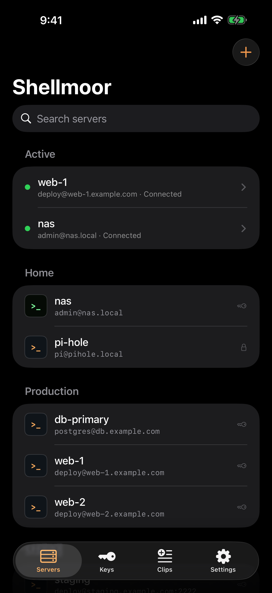
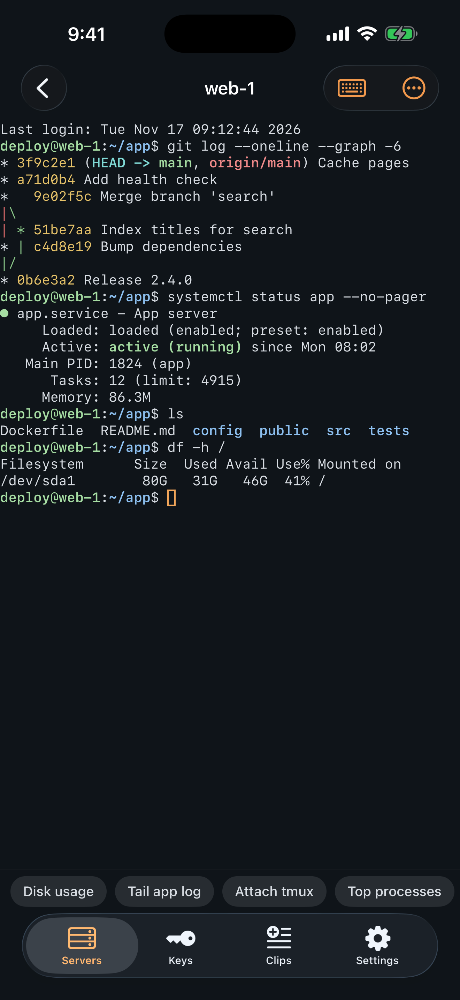
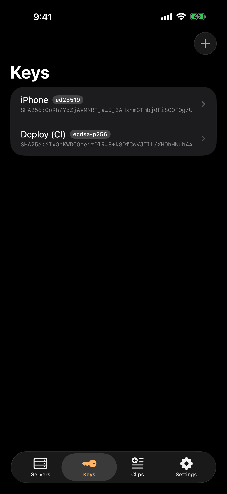
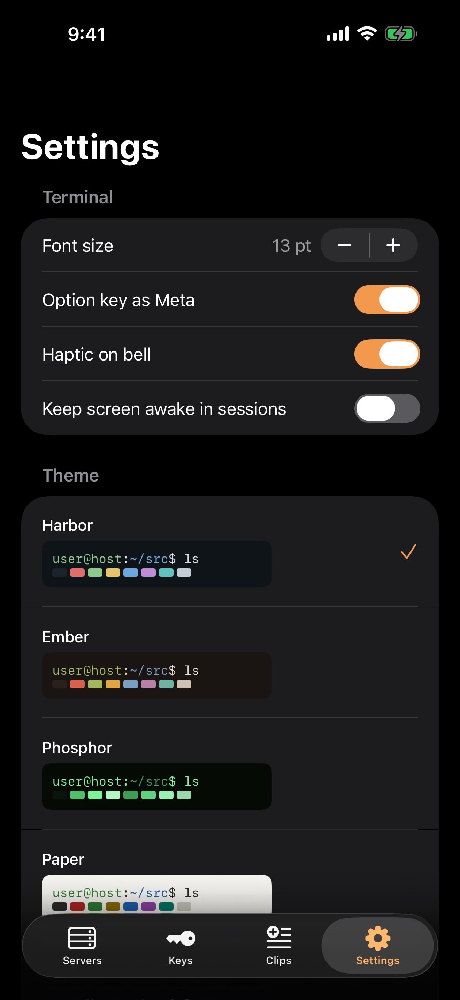

# Shellmoor

An SSH terminal for iPhone and iPad, built with SwiftUI and [xtool](https://github.com/xtool-org/xtool).

Shellmoor was called Tether until 1.1.1. It has a new bundle ID, so it installs as a new app. Pick the same sync
folder and it reads the old `Tether Config.json` and `Tether Secrets.json`, so your servers and keys come along.

<p>   </p>

## Features

- **Servers**: saved hosts with groups, search, duplicate, a startup command and a per-server theme
- **Sessions**: several live sessions at once. Leave a terminal and come back with its scrollback intact. Reconnect with one tap.
- **Terminal**: xterm-256color via SwiftTerm, with the keyboard accessory row (Esc, Ctrl, Tab, arrows, F-keys), mouse reporting, OSC 52 clipboard and links
- **Keys**: generate Ed25519 / ECDSA P-256 on the device, or import OpenSSH/PEM keys. Copy or share the public key. Private keys are kept in the Keychain.
- **Host key verification**: trust on first use, a loud warning when a key changes, and a Known Hosts manager
- **Clips**: one-tap commands in a bar under the terminal, global or per server
- **Sync**: pick a folder in iCloud Drive (or any Files location) and Shellmoor keeps your servers, key names, clips, known hosts and settings there. Keys and passwords sync next to them in a file encrypted with your passphrase (PBKDF2-SHA256 + AES-256-GCM), and through iCloud Keychain when the system allows it. This needs no iCloud entitlement, so it works in sideloaded builds and LiveContainer.
- **Themes**: Harbor, Ember, Phosphor, Paper and Dusk, plus font size, Option-as-Meta and haptic bell

## Install

Add this source in SideStore or AltStore:

```
https://raw.githubusercontent.com/crazyquark/shellmoor/main/source.json
```

Or download `Shellmoor.ipa` from the [latest release](https://github.com/crazyquark/shellmoor/releases/latest).

## Build

xtool links dependencies statically, so the app is linked with `-all_load`. Without it, swift-atomics'
runtime-only conformances are dropped and SwiftNIO crashes on the first connection.

```sh
xtool dev build          # unsigned .app in xtool/
xtool auth login         # once, with your Apple ID
xtool dev                # build, sign, install and launch on a connected device
```

## App Store / TestFlight (GitHub Actions)

`.github/workflows/app-store.yml` builds the app with Xcode on a GitHub macOS runner
(free for public repos). `scripts/xcode-prepare.sh` generates the Xcode project from `project.yml`.
It uses the same sources, packages and `Info.plist` as xtool.

- **TestFlight:** runs on every `v*` tag, so `scripts/release.sh` triggers it. You can also run it
  by hand from the Actions tab. It archives the app, signs it with Xcode cloud signing and uploads
  it to App Store Connect. Build numbers get the run number appended (`8` → `8.57`).
- **Screenshots:** run the workflow by hand with *Take App Store screenshots* checked.
  It captures iPhone 6.9" and iPad 13" screenshots, the sizes App Store Connect requires.
  The app's demo mode (`-ShellmoorScreenshot servers|terminal|keys|settings`) fills in sample
  servers and a canned terminal session; nothing connects anywhere. The screenshots are
  attached to the run as the `app-store-screenshots` artifact.

One-time setup:

1. App Store Connect → Users and Access → Integrations → **Team Keys**: create a key with
   the **Admin** role (App Manager is not enough: uploading uses cloud-managed
   distribution signing, which needs Admin). Download the `.p8` file (only possible once)
   and note the key ID and issuer ID. If you already made one for Plain Sign, reuse it.
2. App Store Connect → Apps → **+ New App**, bundle ID `io.github.crazyquark.shellmoor`.
3. GitHub → Settings → Secrets and variables → Actions → add `ASC_KEY_ID`,
   `ASC_ISSUER_ID`, `ASC_KEY_P8` (the file's contents) and `APPLE_TEAM_ID`.

Until the secrets exist, the TestFlight job only checks that the app builds.

After an upload, the **Build status** workflow (run by hand with the build number the
App Store workflow prints, e.g. `8.57`) waits until Apple finishes processing the build
and reports whether it's available in TestFlight.

Testers: App Store Connect → Shellmoor → TestFlight → Internal Testing → create a group, add
team members, and turn on automatic distribution so new builds reach them.

Export compliance: Shellmoor uses standard encryption (SSH, via SwiftNIO SSH and swift-crypto),
so App Store Connect asks about encryption for each build. Setting
`ITSAppUsesNonExemptEncryption` in `Info.plist` also needs the `ITSEncryptionExportComplianceCode`
from App Store Connect (App Information → App Encryption Documentation); without it, uploads are rejected. App Store Connect was answered with
"standard encryption algorithms", and the app is not offered in France (which would need a
French encryption declaration). The public source code is not subject to the US EAR (15 CFR
742.15(b), no notice needed for standard cryptography). For the App Store binary, a
self-classification report (15 CFR 740.17(e)(3), format in Supplement No. 8 to part 742) is
filed once: fill in the placeholders in `docs/export/self-classification-report.csv` (no commas
inside fields) and email it to crypt-supp8@bis.doc.gov and enc@nsa.gov by February 1 of the
year after the first release.

## Release

```sh
scripts/release.sh 1.0.1 "What's new"
```

This builds the .ipa, bumps the version in `Info.plist`, creates the GitHub release, and adds the release to `source.json`.

## Layout

| File | Role |
| --- | --- |
| `SSHConnection.swift` | UI-agnostic SwiftNIO SSH transport: connect, auth, PTY shell, resize |
| `SSHSession.swift` | Binds a connection to a SwiftTerm `TerminalView`, prompts and state |
| `KeyManager.swift` | Key generation, OpenSSH/PEM import, fingerprints |
| `Store.swift` | JSON persistence (secrets go to the Keychain) |
| `ConfigSync.swift` | Sync folder: config file and encrypted secrets file, newest wins |
| `SecretVault.swift` | Passphrase-encrypted container for Keychain items |
| `Vendor/SwiftTerm` | SwiftTerm 1.20.0. Its manifest is patched so the iOS sources build on a Linux host and in Xcode (no build-info plugin). |

## Tests

`Tests/LinuxHarness/run.sh` starts a throwaway sshd on 127.0.0.1:2222. It then drives the real
`SSHConnection` and `KeyManager` against that server: key import, auth, PTY size, TERM, resize,
host-key rejection and error messages. It also round-trips the encrypted secrets file.

## Limitations

- RSA keys and passphrase-protected keys are not supported (swift-nio-ssh only does Ed25519/ECDSA)
- Mosh, port forwarding and jump hosts are not built yet
- Sync is last-writer-wins per file, so changes made on two devices at the same moment are not merged
- iOS suspends sockets in the background, so long-idle sessions drop and need Reconnect
